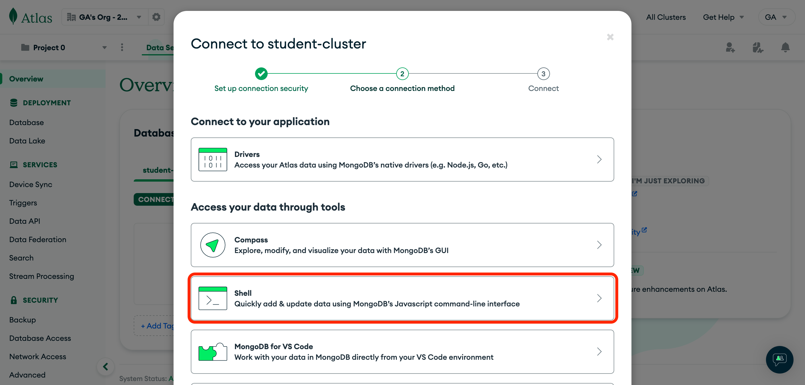
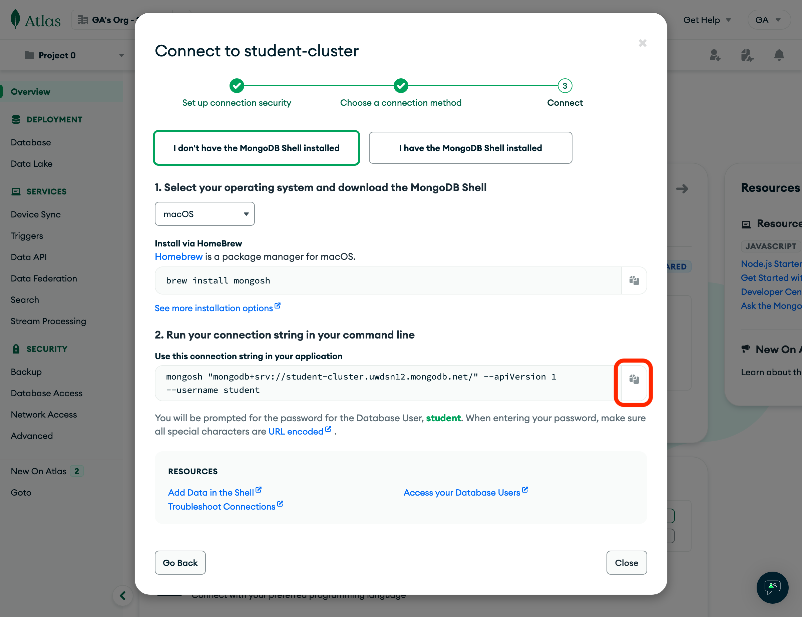
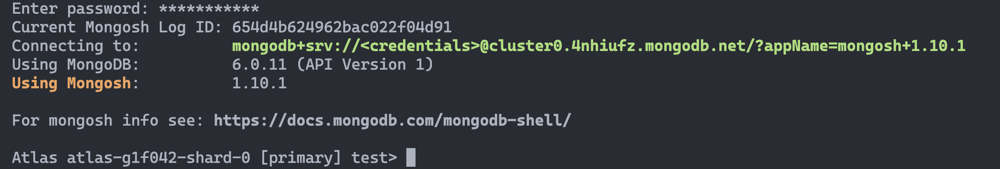
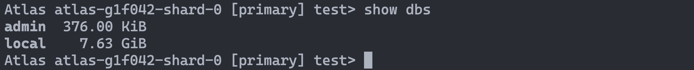

# ![[MongoDB] - Level Up - Create a Database Using MongoDB Shell](./assets/hero.png)

## Open MonogDB Shell Using Atlas

Login to [MongoDB Atlas](https://account.mongodb.com/account/login).

Click the **Connect** button on the **Overview** page, and select **Shell** under the **Access your data through tools** header:



Although Atlas may show how to permanently install `mongosh` (MongoDB's Shell) for your operating system, **it is unnecessary.**

Instead, let's temporarily install and run `mongosh` by copying and pasting the command shown in Atlas into **Terminal**.



> ❗️ Before pressing enter, add `npx` to the front of the command so that the command looks something like this:

```bash
npx mongosh "mongodb+srv://student-cluster.uwdsn12.mongodb.net/" --apiVersion 1 --username <yourusername>
```

If prompted to install, be sure to answer with `y`.

You will be prompted to enter your **database user's** password.

Once the shell is running, you should see the following in the terminal:



## Creating a Database and Inserting Documents in the Mongo Shell

Before we start...

- In this section, we will work directly with MongoDB to create and modify data using the ***Mongo Shell*** in a terminal window.
- However, after this first look at MongoDB, you will be better off using the ***Mongoose ODM.***

### The Mongo Shell

Before rushing ahead to creating our database, let's take a quick look at some command available to us through the shell.

List the shell’s commands available:

```bash
help
```

Cool! Now let's get to making that database. You can take a look at existing databases using the `show` command.

Show the list of databases:

```bash
show dbs
```

More than likely, if this is the first time you are using MongoDB, you should see something like the following:


​
If you would like to show the name of the database that is currently active, use the following command:

```bash
db
```
​
Let's switch to a different database with the `use` command. To do so, follow the `use` command witht the name of the database you would like to switch to:

```bash
use [name of the database to switch to]
```
​
Let’s switch to the local database:

```bash
use local
```

Take a look at the collections of the current database again with the `show` command:

```bash
show collections
```

### Creating a new Database

We can, in fact, utilize the `use` command to not only to switch to another database, but also to ***'create'*** a new database.

To create a new database in the Mongo Shell, we simply have to ***use*** that database, which means inserting data into it.

Let’s create a database named `myDB`:

```bash
use myDB
```

> 📚 Note, if you use the command `show dbs` right now, you ***will not*** see `myDB` in the list because we have not ***used*** it, or inserted any data into it, yet.

### Inserting Data into a Collection

Let's finalize the creation of the `myDB` database by inserting data into it!

This is how we can create and insert a document into a collection named *people*:

```bash
db.people.insert({name: "Fred", age: 21})
```

***Using*** a **collection** for the first time also creates that collection!

👉 **YOU DO - Add Another Document (1 min)**

Add another person to the ***people*** collection. But this time, add a field called ***birthDate*** and assign it a date value with something like this: **new Date(‘3/21/1981’)**

### Reading Documents in a Collection

To list all documents in a collection, we can use the ***find*** method on the collection:

```bash
db.people.find({})
```

The argument passed in to the `find()` method is called a ***query object*** and is used to specify criteria. When we provide an empty query object `{}`, the `find()` method will return **all** documents.

Here's how we can find **'person'** documents with a specific name:

```bash
db.people.find({name: 'Fred'})
```

### Exit the MongoDB Shell

Type `exit` or `quit` to exit the shell.